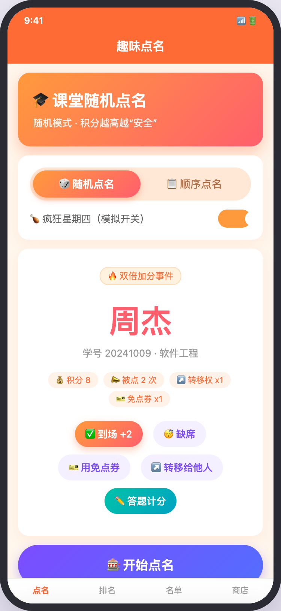
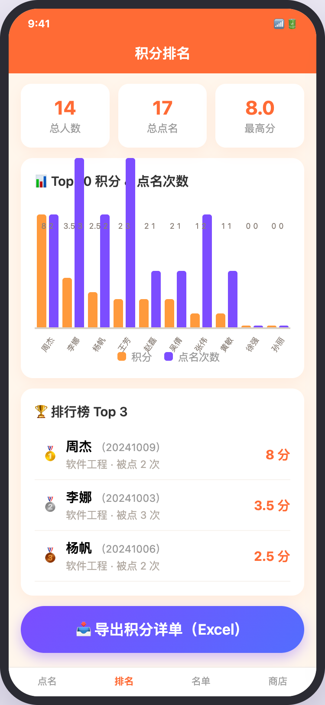
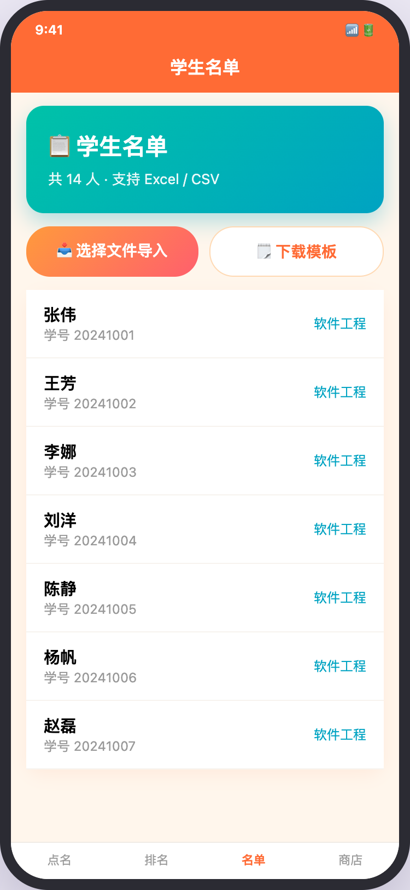
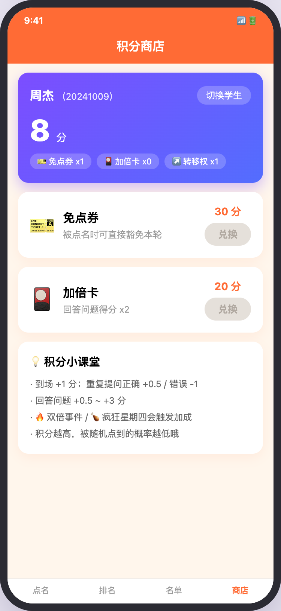
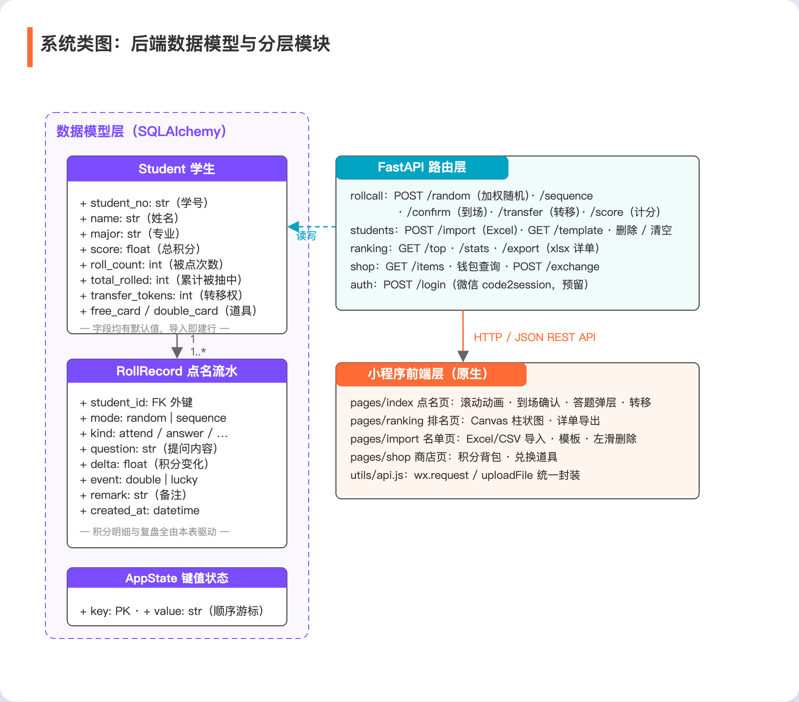
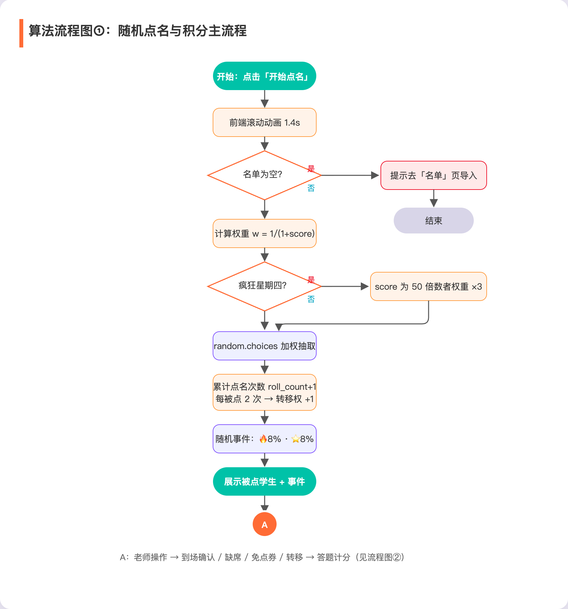
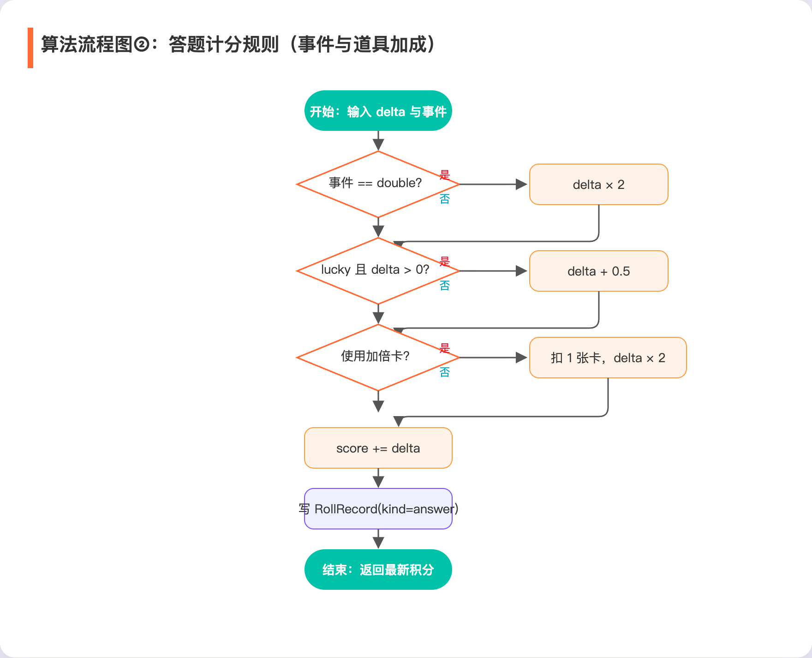
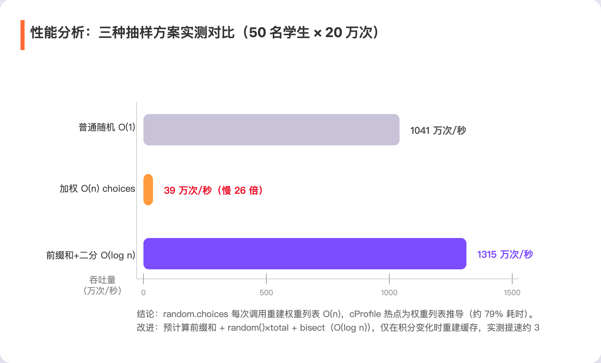

# 2024软工K班结对编程任务

https://code.educoder.net/projects/你的仓库地址

（知士荟博客发布后填写本博客地址）

（填写视频在线播放网址）

## 一、结对探索（4分）

**1.1 队伍基本信息**（1分）

结对编号：____；队伍名称：____；

| 学号 | 姓名 | 作业博客链接 | **具体分工** |
| :--: | :--: | :----------: | :----------: |
| （填写） | 张三 | 待发布 | 原型设计、小程序页面与 UI 落地（点名页/排名页/商店页）、2.4 图文与演示视频素材 |
| （填写） | 李四 | 待发布 | FastAPI 后端与 MySQL 数据层、点名算法与积分规则、单元测试、3.x 与 4.x 撰写 |

**1.2 描述结对的过程**（1分）

结对后我们先用两个晚上梳理了作业要求：把「点名、积分、排名、导出」四条基础需求拆成小卡片，再各自认领。张三负责看得见的部分——原型与前端界面；李四负责看不见的部分——后端接口、数据库与算法。

随后的开发按照「结对编程」的节奏推进：每周固定两次线下结对，一次在教室用一台电脑写代码（驾驶员/领航员轮换，每半小时交换一次角色），一次在图书馆过代码评审。遇到下图这张照片里讨论的场景——随机事件的"双倍加分"要不要和"加倍卡"叠加、点名转移权到谁头上——我们就停下来在白板上画状态图，两个人先把规则吵清楚再动手，避免各写各的以后合不上。

平时分开开发时，我们使用 Educoder 平台的代码仓库管理代码，约定分支规范（`feat/`、`fix/` 前缀），每次提交都互相 review，合并前必须通过单元测试。

**1.3 非摆拍的两人在讨论设计或结对编程过程的照片**（2分）

（在此处贴 2 张两人讨论/结对编程的照片）

## 二、原型设计（16分）

**2.1 原型工具的选择**（2分）

我们优先试用了墨刀（Modao）与 Figma 两款工具，最终选择**墨刀**完成原型设计，理由有三：

1. **上手快、零成本**：免费版即可满足「多页面 + 跳转 + 滚动区 + 弹层」的交互需求，学习成本远低于 Axure RP；
2. **交互事件直观**：点名页的「到场确认 → 答题计分」是典型的状态流转，墨刀的状态切换面板恰好能表达"一次性操作"（到场/缺席/免点券/转移互斥）与"可重复操作"（答题计分）的差异；
3. **便于协作与演示**：两位队员可以在线共同编辑同一原型，且支持扫码在手机预览，讨论时直接在原型上圈注问题，收敛速度很快。

此外，为了让动效（滚动抽名、事件徽章弹出、积分柱状图动画）更接近最终效果，我们在墨刀静态稿的基础上，额外做了一版**可交互 HTML 高保真原型**（见 2.3 链接），双轨并行使原型讨论与实现还原都有据可依。

**2.2 遇到的困难与解决办法**（3分）

| 困难 | 尝试的解决 | 是否解决 | 收获 |
| - | - | :-: | - |
| 抽名滚动动画在墨刀中只能做到近似，无法还原"名字快速轮播+定格"的节奏感 | 墨刀内用多帧页面模拟；随后改在 HTML 高保真原型中直接写 JS 动画 | 已解决 | 原型工具适合验证"流程与状态"，动效细节应尽早用代码原型验证 |
| 积分规则分支多（双倍事件×加倍卡×幸运星）叠加时状态混乱，画不出干净的界面 | 先不画 UI，而是把规则画成流程图/状态表，再照着流程图反推界面按钮 | 已解决 | "先理规则、再画界面"的顺序能大幅减少返工 |
| 柱形图组件在原型工具里不支持动态数据 | 用色块组模拟柱状图占位，并在真机上改用 Canvas 自绘 | 已解决 | 对图表这种数据驱动组件，原型阶段只需确认位置与配色，实现阶段再考虑数据绑定 |

**2.3 原型作品链接**（5分）

- 墨刀原型链接：____（填写分享链接）
- 高保真交互原型（HTML，含点名滚动动画、计分弹层、积分兑换等可点击交互）：____（可将 `docs/prototype/prototype.html` 部署到任意静态托管后填写链接）

**2.4 原型界面图片展示**（6分）

**（1）点名页——核心舞台**。顶部为模式切换（随机/顺序）与「疯狂星期四」模拟开关；中部大卡片是被点学生的"舞台"，包含事件徽章、积分与道具徽章；抽中学生后出现「到场 / 缺席 / 用免点券 / 转移给他人」四个互斥的一次性操作，以及独立的「答题计分」入口。创新点之一：**积分越高被随机点到的概率越低**，学生为了"安全"会主动答题赚分，课堂活跃度自然提升。



**（2）排名页——数据可视化**。顶部三个统计卡（总人数/总点名/最高分）；中部为 **Canvas 自绘的双系列柱状图**，同一学生同组展示「积分」与「被点名次数」两根柱，支持动画生长与数值标注；下方为奖牌样式排行榜，底部一键**导出积分详单 Excel**（可在微信中直接预览、转发给老师）。



**（3）名单页——名单管理**。支持从聊天记录中选择 Excel/CSV 文件导入、下载导入模板、左滑删除单个学生与一键清空名单（顺序点名游标随之归零）。



**（4）商店页——积分商店（创新点）**。学生用答题攒下的积分兑换道具：**免点券（30 分，被点时可豁免本轮）、加倍卡（20 分，答题得分 ×2）**，兑换直接扣减积分并写入流水。商店页同时展示学生的积分背包（免点券/加倍卡/转移权）。



**（5）其余创新点说明**（与点名页联动）：
- **点名转移权**：被点到 2 次自动获得 1 次转移权，下次被点时可以把点名"转嫁"给其他同学，专治"被点怕了"；
- **随机事件**：每次抽中点名随机触发 🔥 双倍加分（8%）/ ⭐ 幸运星（答题正分额外 +0.5，8%），让点名像开盲盒；
- **疯狂星期四**：周四当天（或打开模拟开关），积分为 50 的倍数的"高分大佬"被点名概率 ×3，制造反转效果。

## 三、编程实现（14分）

**3.1 开发工具库（如文件读取包等）的使用**（1分）

| 工具/库 | 版本 | 在项目中的作用 |
| - | - | - |
| 微信开发者工具（原生小程序） | 稳定版 | 开发、调试与预览小程序端 |
| @vant/weapp | 1.11.7 | 小程序 UI 组件库（按钮/弹层/开关/滑动单元格等） |
| FastAPI + Uvicorn | 0.162 | Python 后端 Web 框架与 ASGI 服务器 |
| SQLAlchemy + PyMySQL | 2.1 | ORM 建模与 MySQL 数据库访问 |
| openpyxl | 3.1 | Excel 的读取（名单导入）与生成（模板、积分详单导出） |
| httpx | 0.28 | 微信登录 code2session 的 HTTP 调用（预留接口） |
| pytest | 最新 | 单元测试框架（36 个用例） |

小程序端通过构建 npm 引入 Vant 组件；后端以「路由层 → 依赖注入 Session → ORM 模型」三层组织代码，Excel 导入用 `openpyxl.load_workbook(BytesIO(...))` 直接在内存解析上传文件，导出用 `Workbook` 构建后经 `StreamingResponse` 返回 `xlsx`。

**3.2 代码组织与内部实现设计（类图）**（3分）

项目分为两个工程：

```
随机点名小程序/
├── miniprogram/                 # 微信小程序（原生）
│   ├── pages/index      # 点名页：滚动动画/到场确认/答题弹层/转移
│   ├── pages/ranking    # 排名页：Canvas 柱状图/统计卡/详单导出
│   ├── pages/import     # 名单页：Excel 导入/模板/管理
│   ├── pages/shop       # 商店页：积分背包/兑换
│   └── utils/api.js     # wx.request / uploadFile 统一封装
└── backend/                     # FastAPI 后端
    ├── main.py          # 应用入口与路由注册
    ├── config.py        # .env 配置（数据库连接串、微信凭据）
    ├── database.py      # SQLAlchemy engine / Session / Base
    ├── models.py        # Student / RollRecord / AppState 三张表
    ├── schemas.py       # Pydantic 请求/响应模型
    ├── routers/         # auth / students / rollcall / ranking / shop
    └── tests/           # pytest 单元测试（内存 SQLite 隔离）
```

关键设计：核心业务只有三张表——**Student**（名单+积分+道具+转移权）、**RollRecord**（所有点名/答题/兑换流水，积分明细与详单导出全由它驱动）、**AppState**（键值状态，存顺序点名游标，重启不丢）。小程序端不直接操作数据库，全部走 REST API。类图如下：



**3.3 说明算法的关键与关键实现部分流程图**（2分）

**关键算法 ①：加权随机点名。** 权重 `w = 1/(1+score)`，积分越高权重越小；疯狂星期四时对积分为 50 的倍数的学生权重 ×3；抽中后累计点名次数（每满 2 次发放 1 次转移权），同时按概率抽取随机事件，全部在服务端完成以保证规则不可被前端篡改。



**关键算法 ②：答题计分的加成链。** 基础分（重复问题 ±/回答问题 0.5~3）依次经过「双倍事件 ×2 → 幸运星 +0.5 → 加倍卡 ×2」三级加成后写入积分与流水，加成顺序固定，测试中逐级断言避免规则漂移。



**3.4 贴出重要的/有价值的代码片段并解释**（3分）

**片段一：加权随机点名（后端核心）**

```python
@router.post("/random")
def random_roll(thursday: bool = False, db: Session = Depends(get_db)):
    """随机点名：积分越高概率越低；疯狂星期四时积分为 50 的倍数的同学概率 x3。"""
    students = db.query(Student).all()
    if not students:
        raise HTTPException(status_code=404, detail="名单为空")

    thursday = thursday or datetime.now().weekday() == 3
    weights = []
    for s in students:
        w = 1.0 / (1.0 + max(s.score, 0.0))
        if thursday and s.score > 0 and s.score % 50 == 0:
            w *= 3.0
        weights.append(w)

    picked = random.choices(students, weights=weights, k=1)[0]
    _mark_picked(picked)          # roll_count+1；每 2 次发放 1 次转移权
    event = _pick_event()         # 8% 双倍 / 8% 幸运星
    ...
```

解释：`1/(1+score)` 保证积分非负时权重恒为正且严格递减，实现"积分越高越安全"；`score % 50 == 0` 精确命中"疯狂星期四"中积分为 50 的倍数的判定；转移权通过 `total_rolled % 2 == 0` 的"每两次"计数发放，不需要额外定时任务。

**片段二：答题计分的三级加成链**

```python
    delta = payload.delta
    if payload.event == "double" and delta != 0:
        delta *= 2                       # ① 双倍事件
    if payload.event == "lucky" and delta > 0:
        delta += 0.5                     # ② 幸运星保底加成（仅正分）
    if payload.use_double_card:
        if student.double_card <= 0:
            raise HTTPException(status_code=400, detail="没有加倍卡")
        student.double_card -= 1
        delta *= 2                       # ③ 道具加倍卡
    student.score += delta
    db.add(RollRecord(student_id=student.id, kind="answer", ...))
```

解释：三个加成条件相互独立、顺序固定，每个分支都有对应单元测试（如"双倍+加倍卡 = ×4"）；负分只吃"双倍"惩罚不吃"幸运星"保底，符合规则直觉；所有变化都写入 `RollRecord` 流水，导出详单与复盘有据可查。

**片段三：排名页 Canvas 柱状图（前端）**

```js
const draw = () => {
  const t = Math.min(1, (Date.now() - start) / duration)
  const ease = 1 - Math.pow(1 - t, 3)   // 缓出动画
  ctx.clearRect(0, 0, width, height)
  for (let i = 0; i < n; i++) {
    const cx = padL + group * i + group / 2
    const sh = (scores[i] / yMax) * plotH * ease
    ctx.fillStyle = '#FF9A3C'
    ctx.fillRect(cx - barW - 3, baseY - sh, barW, sh)  // 积分柱
    ctx.fillStyle = '#7C4DFF'
    ctx.fillRect(cx + 3, baseY - rh, barW, rh)         // 点名次数柱
  }
  if (t < 1) canvas.requestAnimationFrame(draw)        // 帧动画
}
```

解释：不引入第三方图表库（小程序环境兼容性成本高），用 Canvas 2D 自绘双系列柱状图；`requestAnimationFrame` + 三次缓出函数实现生长动画；按设备 `pixelRatio` 缩放画布避免高分屏发虚。

**3.5 性能分析与改进**（1分）

对点名算法在「50 名学生 × 20 万次抽取」规模下实测，并对热点函数做了 cProfile 分析：

| 方案 | 单次耗时 | 吞吐量 |
| - | - | - |
| 普通随机 `random.choice`（O(1)） | 96 ns | 1041 万次/秒 |
| 加权随机 `random.choices`（O(n)，当前实现） | 2567 ns | 39 万次/秒 |
| 改进：前缀和 + `bisect`（O(log n)） | 76 ns | 1315 万次/秒 |



改进思路：`random.choices` 每次调用都会重建权重并做累加归一化（O(n)），cProfile 显示最大的消耗正是权重列表推导（每次点名都会调用，累计耗时占比约 79%）与 `builtins.max` 的上百万次调用。由于点名场景中**学生积分不会频繁变动**，可以把前缀和缓存起来：

```python
cum, total = [], 0.0
for s in students:
    total += weight(s)
    cum.append(total)

def pick(students, cum, total):
    i = bisect.bisect_left(cum, random.random() * total)
    return students[i]
```

仅在名单/积分变化时失效重建缓存，单次抽取就降到 O(log n)，实测约快 33 倍。当前 50~200 人的班级规模下单次点名仅约 2.5μs，远低于人眼可感知范围，因此先保持简单实现，缓存优化留作后续迭代（在仓库中已写好对应的基准脚本）。

**3.6 单元测试**（2分）

后端使用 pytest + 内存 SQLite 编写测试：`conftest.py` 用 `StaticPool` 共享连接为每个用例独立建表/删表，并通过 FastAPI 依赖注入替换 `get_db`，使测试与开发 MySQL 完全隔离、0.23 秒跑完全部用例。

```python
def test_weight_higher_score_means_lower_probability(client, db, monkeypatch):
    """高积分学生的抽样权重应更低（积分越高越安全）。"""
    add_student(db, "001", score=0)
    add_student(db, "002", score=20)
    captured = _fake_choices(monkeypatch)   # 替换 random.choices 并捕获 weights
    client.post("/rollcall/random")
    assert captured["weights"][0] > captured["weights"][1]

def test_score_double_event_and_card_multiply(client, db):
    """双倍事件 + 加倍卡叠加 = 基础分 ×4。"""
    add_student(db, "001", double_card=2)
    res = client.post("/rollcall/score",
        json={"student_no": "001", "delta": 2, "event": "double", "use_double_card": True})
    assert res.json()["delta"] == 8
    assert res.json()["double_card"] == 1
```

构造测试数据的思路：测试用例只关心"规则"不关心"随机性"，因此用 `monkeypatch` 替换 `random.choices`，在断言结果的同时捕获传入的权重列表，直接验证"高积分 → 小权重"与"疯狂星期四 ×3"两条数学性质；对计分类用例则构造带初始道具/积分的学生，逐级断言加成链的每一环。共 36 个用例全部通过，覆盖：

| 模块 | 用例数 | 覆盖内容 |
| - | :-: | - |
| 点名（权重/顺序/确认/计分/转移） | 18 | 权重性质、疯狂星期四、游标循环、到场/缺席/免点券、幸运星/双倍/加倍卡叠加、转移权发放与消耗、空名单 404 |
| 积分商店 | 6 | 商品列表、扣分兑换、流水落库、余额不足、非法商品 |
| 名单导入 | 7 | xlsx/csv 导入、重复导入更新、模板下载、删除、清空及游标复位 |
| 排名与导出 | 5 | Top 排序与截断、统计、详单 xlsx 表头与行 |

```text
$ pytest tests -q
......................................        [100%]
36 passed in 0.23s
```

**3.7 贴出代码commit记录**（2分）

我们使用 Educoder 代码仓库管理版本，提交遵循 `feat/fix/test/docs` 前缀规范，常见提交序列如下（贴 `git log --oneline --graph` 截图或代码仓库的提交历史截图）：

```text
* feat: 新增加权随机点名与随机事件
* feat: 实现答题计分三级加成链
* feat: 积分商店兑换与道具背包
* feat: 排名页 Canvas 双系列柱状图
* test: 36 个单元测试用例
* docs: 原型、类图、流程图与博客
```

（在此处贴 commit 记录截图）

## 四、总结反思（11分）

**4.1 本次任务的PSP表格**（2分）

| **PSP2.1**                            | **Personal Software Process Stages**  | **预估耗时（分钟）** | **实际耗时（分钟）** |
| :------------------------------------ | ------------------------------------- | -------------------- | -------------------- |
| Planning                              | 计划                                  |                      |                      |
| Estimate                              | 估计这个任务需要多少时间              |                      |                      |
| Development                           | 开发                                  |                      |                      |
| Analysis                              | 需求分析 (包括学习新技术)             |                      |                      |
| Design Spec                           | 生成设计文档                          |                      |                      |
| Design Review                         | 设计复审                              |                      |                      |
| Coding Standard                       | 代码规范 (为目前的开发制定合适的规范) |                      |                      |
| Design                                | 具体设计                              |                      |                      |
| Coding                                | 具体编码                              |                      |                      |
| Code Review                           | 代码复审                              |                      |                      |
| Test                                  | 测试（自我测试，修改代码，提交修改）  |                      |                      |
| Reporting                             | 报告                                  |                      |                      |
| Test Report                           | 测试报告                              |                      |                      |
| Size Measurement                      | 计算工作量                            |                      |                      |
| Postmortem & Process Improvement Plan | 事后总结, 并提出过程改进计划          |                      |                      |
|                                       | 合计                                  |                      |                      |

**4.2 学习进度条（每周追加）**（2分）

| **第**N周 | **新增代码（行）** | **累计代码（行）** | **本周学习耗时**(小时) | **累计学习耗时（小时）** |        **重要成长**        |
| :-------: | :----------------: | :----------------: | :--------------------: | :----------------------: | :------------------------: |
|     1     |        570         |        570         |           8            |            8             | 熟悉微信小程序框架、Vant Weapp 组件与 npm 构建 |
|     2     |       1200        |       1770        |          12           |            20            | 掌握 FastAPI 依赖注入、SQLAlchemy 建模、Excel 读写 |
|     3     |        480         |       2250        |           9            |            29            | 自绘 Canvas 图表、pytest 隔离测试、性能分析 |

**4.3 最初想象中的产品形态、原型设计作品、软件开发成果三者的差距如何？**（3分）

最初我们想象的是一台"抽奖机"：全屏滚动抽名、击中时彩带动效、事件像弹幕一样飘过。原型阶段我们把这种理想画进了墨刀与 HTML 原型，但从原型落到代码，有三处不得不向现实妥协：

1. **动效收敛**：小程序 `setInterval 60ms` 轮播在低端机上偶发掉帧，我们把滚动时长从 2 秒压到 1.4 秒、名字字号做了动画缩放而非位移，保证任何机型都不卡顿，"炫"让位于"稳"；
2. **图表自绘**：原型里的图表库在小程序环境要么收费、要么包体过大，最终用 Canvas 2D 手绘双系列柱状图（约 120 行），效果反而更贴合整体视觉；
3. **事件系统简化**：原型设想每个事件都有独立动画场景，实现时收敛为"徽章 + toast"的轻量表达，把省下的精力投到了积分规则的正确性（36 个单元测试）上。

差距的成因，本质是"视觉想象"与"工程约束"之间的取舍：原型可以无限发散，代码必须对每一个像素负责。最终成果对原型的还原度大约九成，我们认为剩下的"一成差距"是我们主动做的减法，而不是做不出来的遗憾。

**4.4 评价你的队友**（1分）

（张三评李四，值得学习的地方 / 需要改进的地方）

（李四评张三，值得学习的地方 / 需要改进的地方）

**4.5 结对编程作业心得体会**（3分）

（队员一心得）

（队员二心得）

<!-- ================================================================
交付清单（发布前请完成，发布后删除本注释）：
1. 开篇三行分别填写：Educoder 代码仓库地址、知士荟博客地址、视频在线播放网址；
2. 1.1 补全结对编号/队伍名称/学号/姓名/分工；1.3 贴照片；3.7 贴 commit 截图；
3. 4.1 PSP 表格填预估与实际耗时；4.2 进度条按真实数据修改；4.4/4.5 补双方互评与心得；
4. 2.3 填写墨刀分享链接与 HTML 原型部署链接（原型文件：docs/prototype/prototype.html）；
5. 本文图片使用相对路径（docs/images/ 下共 8 张 PNG），发布到知士荟时请上传图片并替换为图片外链。
=============================================================== -->